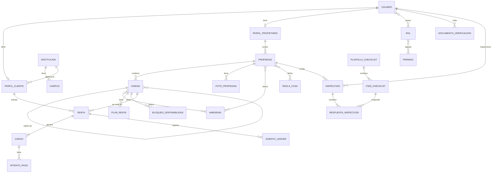
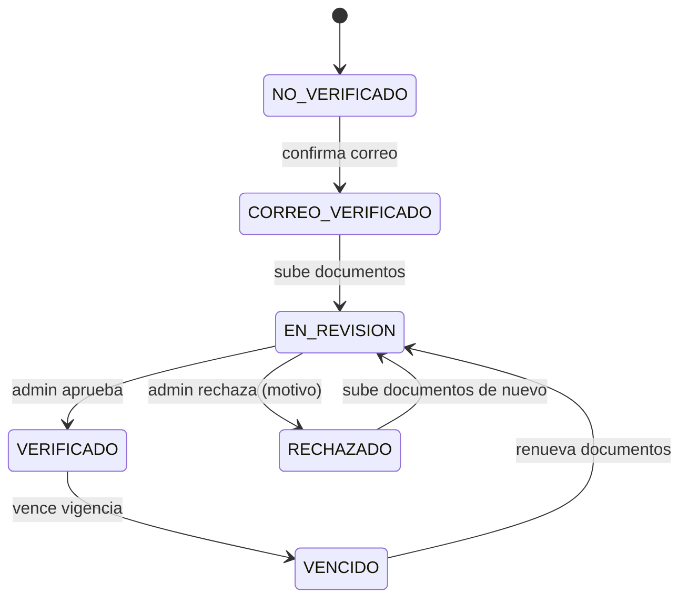
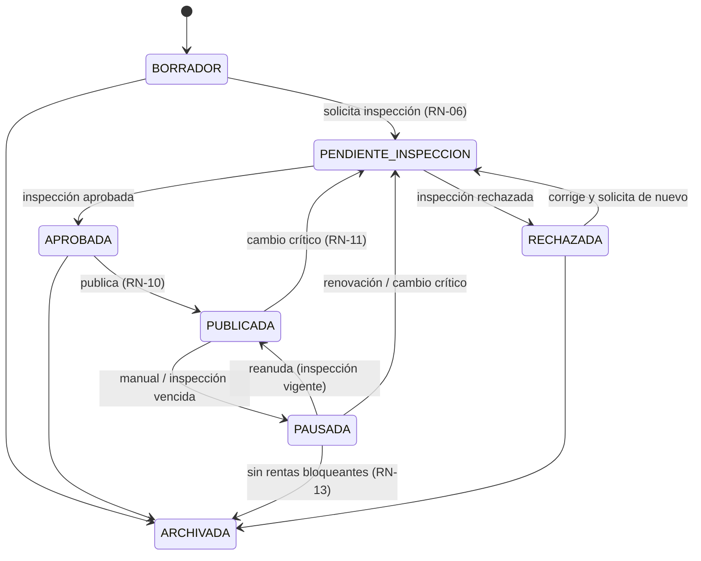
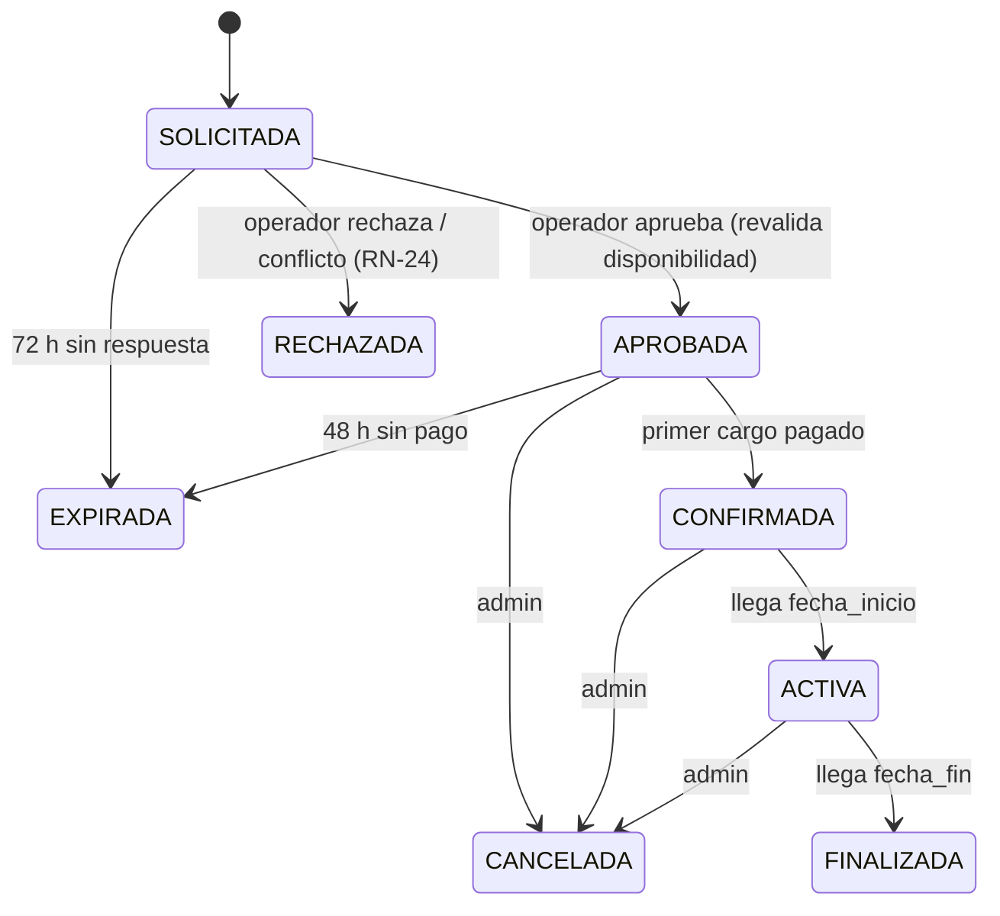
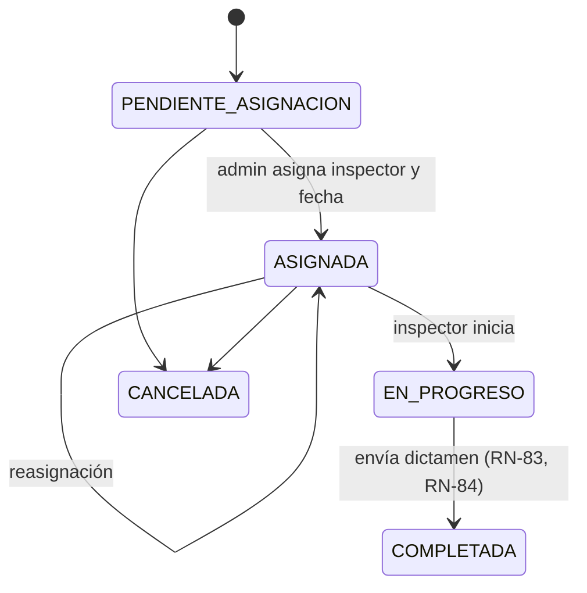

# 04 · Modelo de dominio

Modelo **conceptual**, independiente de la tecnología. Los tipos son lógicos: `id` = identificador único (UUID sugerido), `dinero` = entero en centavos, `pb` = puntos base, `ts` = timestamp UTC.
Campos comunes en todas las entidades de negocio (se omiten en las tablas): `id`, `creado_en`, `actualizado_en`, `eliminado_en` (borrado lógico, donde aplique).

## Módulos y dueños de datos

| Módulo                       | Entidades                                                                               | Publica eventos                                                                                            |
| ---------------------------- | --------------------------------------------------------------------------------------- | ---------------------------------------------------------------------------------------------------------- |
| **Identidad y acceso**       | Usuario, Rol, Permiso                                                                   | `UsuarioRegistrado`, `RolAsignado`                                                                         |
| **Verificación**             | PerfilCliente, PerfilPropietario, DocumentoVerificacion                                 | `UsuarioVerificado`, `VerificacionRechazada`, `VerificacionVencida`                                        |
| **Catálogos**                | Institucion, Campus, Amenidad, ReglaCasa, PlantillaChecklist, ItemChecklist             | —                                                                                                          |
| **Propiedades**              | Propiedad, Unidad, FotoPropiedad, PropiedadAmenidad, UnidadAmenidad, PropiedadReglaCasa | `PropiedadEnviadaAInspeccion`, `PropiedadPublicada`, `CambioCriticoDetectado`                              |
| **Precios y disponibilidad** | PlanRenta, BloqueoDisponibilidad                                                        | `PrecioCambiado`                                                                                           |
| **Rentas**                   | Renta                                                                                   | `RentaSolicitada`, `RentaAprobada`, `RentaRechazada`, `RentaConfirmada`, `RentaExpirada`, `RentaCancelada` |
| **Pagos**                    | Cargo, IntentoPago, AsientoLedger, ReglaComision                                        | `CargoPagado`, `CargoFallido`, `CargoVencido`                                                              |
| **Inspecciones**             | Inspeccion, RespuestaInspeccion                                                         | `InspeccionAsignada`, `InspeccionCompletada`, `InspeccionPorVencer`                                        |
| **Archivos**                 | Archivo                                                                                 | —                                                                                                          |
| **Notificaciones**           | Notificacion, PreferenciaNotificacion                                                   | (consume eventos de los demás módulos)                                                                     |
| **Auditoría**                | EventoAuditoria                                                                         | (consume eventos de los demás módulos)                                                                     |

Regla de modularidad: un módulo **no accede directamente a las tablas de otro**. Usa su interfaz pública o reacciona a sus eventos.

## Diagrama de relaciones

## Entidades

### Identidad y verificación

**Usuario**

| Campo               | Tipo        | Notas                                                           |
| ------------------- | ----------- | --------------------------------------------------------------- |
| email               | texto único | Correo de acceso                                                |
| credencial_acceso   | —           | Hash de contraseña o proveedor externo (se define con el stack) |
| nombre, apellidos   | texto       |                                                                 |
| telefono            | texto       | Opcional                                                        |
| fecha_nacimiento    | fecha       | Obligatoria. Política de menores pendiente (RN-05)              |
| genero_convivencia  | enum?       | `MUJER` \| `HOMBRE` \| null. Opcional, privado (RN-32)          |
| estado              | enum        | `ACTIVO` \| `SUSPENDIDO`                                        |
| email_verificado_en | ts?         |                                                                 |

**Rol / Permiso / UsuarioRol / RolPermiso**: RBAC estándar (ver [02](02-roles-permisos.md)).

**PerfilCliente**

| Campo               | Tipo   | Notas                                                 |
| ------------------- | ------ | ----------------------------------------------------- |
| usuario_id          | id     | 1:1                                                   |
| tipo_comunidad      | enum   | `DOCENTE` \| `ESTUDIANTE` \| `ESTUDIANTE_INTERCAMBIO` |
| institucion_id      | id     | Institución destino                                   |
| estado_verificacion | enum   | Ver máquina de estados                                |
| verificado_hasta    | fecha? | RN-04                                                 |

**PerfilPropietario**

| Campo               | Tipo  | Notas                           |
| ------------------- | ----- | ------------------------------- |
| usuario_id          | id    | 1:1                             |
| estado_verificacion | enum  | Mismo ciclo que el cliente      |
| datos_fiscales      | json? | RFC u otros. Opcional en el MVP |

**DocumentoVerificacion**

| Campo                                     | Tipo   | Notas                                                                                     |
| ----------------------------------------- | ------ | ----------------------------------------------------------------------------------------- |
| usuario_id                                | id     |                                                                                           |
| tipo                                      | enum   | `CREDENCIAL` \| `CARTA_ACEPTACION` \| `IDENTIFICACION_OFICIAL` \| `COMPROBANTE_PROPIEDAD` |
| archivo_id                                | id     | Archivo **privado**                                                                       |
| propiedad_id                              | id?    | Solo para `COMPROBANTE_PROPIEDAD`                                                         |
| estado                                    | enum   | `PENDIENTE` \| `APROBADO` \| `RECHAZADO`                                                  |
| vigente_hasta                             | fecha? | Por ejemplo, el fin de estancia en la carta                                               |
| revisado_por, revisado_en, motivo_rechazo |        |                                                                                           |

### Catálogos

**Institucion**: nombre, siglas, `dominios_correo[]`, activo.
**Campus**: institucion_id, nombre, dirección, `lat`, `lng`.
**Amenidad**: nombre, icono, categoría, `ambito` (`PROPIEDAD` \| `UNIDAD` \| `AMBOS`), activo.
**ReglaCasa**: nombre (mascotas, fumar, fiestas, visitas nocturnas, horario de silencio), descripción, activo.
**PlantillaChecklist**: nombre, `version`, `vigente` (bool). Una versión publicada es **inmutable**.
**ItemChecklist**: plantilla_id, categoría (eléctrico, gas, seguridad, higiene, estructura, fidelidad de fotos…), texto, `ambito` (`PROPIEDAD` \| `UNIDAD`), `critico` (bool), `requiere_foto` (bool), orden.

### Propiedades

**Propiedad**

| Campo                                            | Tipo    | Notas                                                        |
| ------------------------------------------------ | ------- | ------------------------------------------------------------ |
| propietario_id                                   | id      |                                                              |
| modalidad_gestion                                | enum    | `AUTOGESTIONADA` \| `ADMINISTRADA`                           |
| titulo, descripcion                              | texto   |                                                              |
| tipo_inmueble                                    | enum    | `CASA` \| `DEPARTAMENTO` \| `CUARTO_EN_CASA` \| `OTRO`       |
| calle, numero, colonia, ciudad, estado, cp, pais | texto   | Dirección exacta: **privada hasta que la renta se confirma** |
| lat, lng                                         | decimal | Se muestran aproximados en el catálogo                       |
| estado                                           | enum    | Ver máquina de estados                                       |
| motivo_pausa                                     | enum?   | `MANUAL` \| `INSPECCION_VENCIDA`                             |
| inspeccion_vigente_id                            | id?     |                                                              |
| inspeccion_vigente_hasta                         | fecha?  |                                                              |
| regla_genero                                     | enum    | Default `MIXTO`                                              |
| comunidades_permitidas                           | enum[]  | Vacío = todas                                                |
| creada_por                                       | id      | Propietario o administrador (RN-15)                          |

**Unidad**

| Campo                  | Tipo    | Notas                                                                   |
| ---------------------- | ------- | ----------------------------------------------------------------------- |
| propiedad_id           | id      |                                                                         |
| padre_id               | id?     | Jerarquía (RN-20)                                                       |
| tipo                   | enum    | `COMPLETA` \| `HABITACION_PRIVADA` \| `HABITACION_COMPARTIDA` \| `CAMA` |
| nombre, descripcion    | texto   | Por ejemplo, "Habitación 2", "Cama A"                                   |
| capacidad              | entero  | Personas                                                                |
| rentable               | bool    | RN-21                                                                   |
| deposito               | dinero  | RN-44                                                                   |
| regla_genero           | enum?   | null = hereda (RN-30)                                                   |
| comunidades_permitidas | enum[]? | null = hereda (RN-31)                                                   |
| estado                 | enum    | `ACTIVA` \| `PAUSADA`                                                   |

**FotoPropiedad**: propiedad_id, `unidad_id?` (foto de una unidad específica), archivo_id, orden, es_portada, texto_alternativo.
**PropiedadAmenidad / UnidadAmenidad**: tablas de relación.
**PropiedadReglaCasa**: propiedad_id, regla_casa_id, permitido (bool), nota.

### Precios y disponibilidad

**PlanRenta**

| Campo                      | Tipo   | Notas                               |
| -------------------------- | ------ | ----------------------------------- |
| unidad_id                  | id     |                                     |
| periodo                    | enum   | `SEMANAL` \| `MENSUAL` \| `ANUAL`   |
| precio                     | dinero | Por periodo                         |
| moneda                     | texto  | `MXN`                               |
| min_periodos, max_periodos | entero | RN-43                               |
| activo                     | bool   | Máx. 1 activo por (unidad, periodo) |

**BloqueoDisponibilidad**: unidad_id, inicio, fin, motivo (`MANTENIMIENTO` \| `USO_PROPIETARIO` \| `OTRO`), nota, creado_por.

### Rentas

**Renta**

| Campo                                           | Tipo        | Notas                                                  |
| ----------------------------------------------- | ----------- | ------------------------------------------------------ |
| folio                                           | texto único | Legible, por ejemplo `R-2026-000123`                   |
| unidad_id, propiedad_id                         | id          | `propiedad_id` desnormalizado para consultas y bloqueo |
| cliente_id                                      | id          |                                                        |
| periodo                                         | enum        | Copia del plan                                         |
| num_periodos                                    | entero      |                                                        |
| fecha_inicio, fecha_fin                         | fecha       | `[inicio, fin)`, fin calculada (RN-42)                 |
| precio_periodo                                  | dinero      | Copia                                                  |
| total_renta                                     | dinero      | Copia                                                  |
| deposito                                        | dinero      | Copia                                                  |
| modalidad_gestion                               | enum        | Copia                                                  |
| comision_pb                                     | entero      | Copia (1000 / 2000)                                    |
| estado                                          | enum        | Ver máquina de estados                                 |
| mensaje_cliente                                 | texto?      | Presentación al operador                               |
| reglas_aceptadas_en                             | ts          | RN-33                                                  |
| expira_en                                       | ts?         | RN-61 / RN-62                                          |
| decidida_por, decidida_en, motivo_rechazo       |             |                                                        |
| cancelada_por, cancelada_en, motivo_cancelacion |             |                                                        |

### Pagos

**ReglaComision**: modalidad_gestion, `porcentaje_pb`, vigente_desde, vigente_hasta?.

**Cargo**

| Campo                       | Tipo   | Notas                                                            |
| --------------------------- | ------ | ---------------------------------------------------------------- |
| renta_id                    | id     |                                                                  |
| numero                      | entero | 1..N                                                             |
| concepto                    | enum   | `RENTA` \| `RENTA_Y_DEPOSITO`                                    |
| monto_renta, monto_deposito | dinero | Separados para el ledger                                         |
| vence_en                    | fecha  |                                                                  |
| estado                      | enum   | `PENDIENTE` \| `PAGADO` \| `FALLIDO` \| `VENCIDO` \| `CANCELADO` |
| pagado_en                   | ts?    |                                                                  |

**IntentoPago**: cargo_id, pasarela (`SIMULADA`), referencia_externa, monto, estado (`PROCESANDO` \| `EXITOSO` \| `FALLIDO`), respuesta (json), procesado_en.

**AsientoLedger** (inmutable, partida doble)

| Campo              | Tipo   | Notas                                                                                    |
| ------------------ | ------ | ---------------------------------------------------------------------------------------- |
| transaccion_id     | id     | Agrupa débitos y créditos que suman cero                                                 |
| cuenta             | enum   | `CLIENTE` \| `PLATAFORMA_COMISION` \| `PROPIETARIO_POR_PAGAR` \| `DEPOSITOS_EN_GARANTIA` |
| titular_id         | id?    | Cliente o propietario, según la cuenta                                                   |
| renta_id, cargo_id | id     |                                                                                          |
| tipo               | enum   | `DEBITO` \| `CREDITO`                                                                    |
| monto              | dinero |                                                                                          |

### Inspecciones

**Inspeccion**

| Campo                          | Tipo   | Notas                                                     |
| ------------------------------ | ------ | --------------------------------------------------------- |
| propiedad_id                   | id     |                                                           |
| tipo                           | enum   | `ALTA` \| `POR_CAMBIO` \| `RENOVACION`                    |
| plantilla_id                   | id     | Versión congelada (RN-82)                                 |
| inspector_id                   | id?    |                                                           |
| asignada_por, fecha_programada |        |                                                           |
| estado                         | enum   | Ver máquina de estados                                    |
| resultado                      | enum?  | `APROBADA` \| `APROBADA_CON_OBSERVACIONES` \| `RECHAZADA` |
| observaciones                  | texto  | Visibles al propietario                                   |
| completada_en                  | ts?    |                                                           |
| vigente_hasta                  | fecha? | completada_en + 12 meses si se aprueba                    |

**RespuestaInspeccion**: inspeccion_id, item_id, `unidad_id?` (para ítems de ámbito unidad), resultado (`CUMPLE` \| `NO_CUMPLE` \| `NO_APLICA`), comentario, `archivos[]`.

### Transversales

**Archivo**: visibilidad (`PUBLICO` \| `PRIVADO`), ruta, mime, tamaño, hash, subido_por.
**Notificacion**: usuario_id, tipo, canal (`EMAIL` \| `IN_APP`), datos (json), enviada_en, leida_en.
**EventoAuditoria**: actor_id, entidad, entidad_id, acción, antes (json), después (json), ip, creado_en.

## Máquinas de estado

### Verificación (cliente y propietario)

### Propiedad

### Renta

### Inspección

## Notas de implementación (independientes del stack)

- **Árbol de unidades:** la profundidad máxima es 3 (COMPLETA → HABITACION_COMPARTIDA → CAMA), así que basta con `padre_id` y consultas de ancestros y descendientes. No hace falta un modelo de árbol especializado.
- **Disponibilidad:** índice por `(unidad_id, fecha_inicio, fecha_fin)` sobre rentas bloqueantes. La concurrencia se resuelve con un bloqueo de fila sobre `Propiedad` dentro de la transacción (RN-25).
- **Tareas programadas** (jobs): expiración de solicitudes y pagos, transiciones ACTIVA/FINALIZADA, cargos vencidos, vencimiento de verificaciones e inspecciones, avisos previos. Deben ser **idempotentes**.
- **Eventos de dominio:** publicarlos con el patrón _outbox_ (se guardan en la misma transacción que el cambio) para no perder notificaciones ni auditoría.
- **Búsqueda geográfica:** la distancia al campus requiere índices espaciales o un cálculo por bounding box. Se define con el stack.
